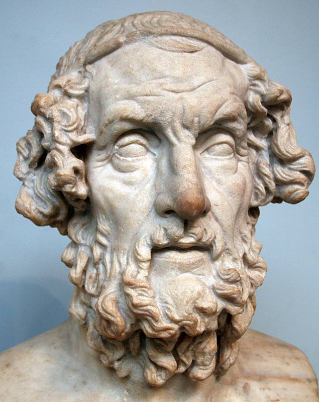

两部史诗庄严开篇，都唤着一个名字："女神啊，请歌唱珀琉斯之子阿喀琉斯的愤怒"——歌唱者悬请缪斯，而缪斯的代言人，传统上叫荷马。可这位奠定了整个西方文学起点的人物，我们几乎一无所知：他是谁？生活在什么时候？真的存在过吗？

### 古人怎么说

希腊人自己从不怀疑荷马存在。他们相信他是盲诗人，出生于小亚细亚沿海（士麦那或希俄斯岛被争抢为故乡），生活在公元前八世纪左右。希俄斯岛的"荷马宗族"（Homeridae）世代传唱他的诗。柏拉图称他为"希腊的教育者"，亚历山大大帝出征时枕下常备一部《伊利亚特》。但古人同样记录着争议：至少从公元前六世纪起，就有人怀疑《伊利亚特》《奥德赛》并非出自同一人之手。

> 荷马胸像，大英博物馆藏。罗马时代的摹品，一般认为仿约公元前二世纪的希腊原作——双目失明、须发卷曲的老歌者形象，正是古人心中"荷马"的样子。图源：维基共享资源（公有领域）。

### "荷马问题"的诞生

近代学术把疑问推向系统化。1795 年，德国学者沃尔夫（F. A. Wolf）发表《荷马史诗引论》，指出在没有文字的时代，如此浩瀚的篇幅不可能由一人一时写定，必是长期口传的累积。"荷马是谁"由此变成"荷马是什么"。

二十世纪给出了迄今最有说服力的答案。美国学者米尔曼·帕里（Milman Parry）在南斯拉夫乡间记录民间歌手的现场演唱，发现他们都依靠大量现成的"程式"——固定的短语、句套与场景模板——边想边唱，即兴成篇。史诗中的"捷足的阿喀琉斯""白臂女神赫拉""酒色的海"，正是这套口传机器的齿轮。帕里与他的学生洛德（Albert Lord）由此提出：荷马史诗是口传传统的结晶，"荷马"或许是把传统熔铸成形的某位（或某几位）天才歌手的名字。

### 体量与抄本

这份"无名者"的遗产体量惊人：《伊利亚特》15,693 行，《奥德赛》12,110 行，各分二十四卷。亚历山大里亚的学者为它分卷、校勘、立注；此后辗转抄写近千年，今天所见最早的完整抄本"威尼斯抄本 A"（Venetus A）约抄写于公元十世纪，页缘密密麻麻写满古代学者的注疏，是近代校勘本的主要底本。从十九世纪的卢德维希（Arthur Ludwich），到二十一世纪的韦斯特（M. L. West），校勘家仍在逐行打磨文本；自2000年起陆续出版的"巴塞尔评注"（Basler Kommentar）则是当代最完备的荷马注疏。一部口传的歌，就这样被一代代人护送到今天。

### 一个务实的态度

对普通读者来说，也许不必执着于"一个人"：可以把"荷马"理解为一位无名的集体天才——无数代歌者把特洛伊战争的故事传唱了几个世纪，最终在公元前八至前六世纪之间，由掌握文字的一代将定本写下。诗仍在，歌者的名字并不妨碍我们听见歌。
