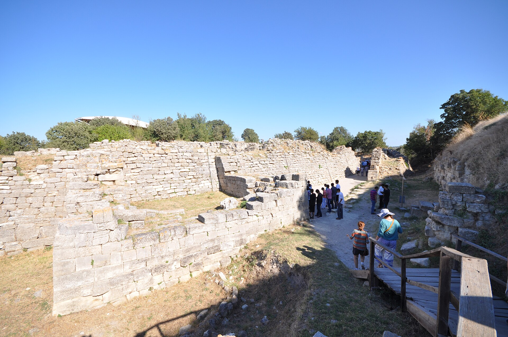

两千年来，特洛伊被视为传说。直到十九世纪，一个相信荷马的德国商人真的挖出了一座城。

### 谢里曼与九层土丘

1871 年起，德国实业家海因里希·谢里曼（Heinrich Schliemann）在土耳其西北的希萨利克（Hisarlik）土丘动土。他自幼痴迷《伊利亚特》，认定普里阿摩斯的城就在脚下。他真挖出了层层叠叠的古城遗址——土丘上先后叠压着九个时期的聚落，从公元前三千纪直到罗马时代。谢里曼认定第二层是特洛伊（其实早了一千多年），后来的学者认定：第六、第七层（约公元前十三世纪）才最接近荷马笔下的城市——有宏伟的斜墙、高大的城门，第七层还留有战乱与火灾的痕迹。

> 希萨利克土丘上的特洛伊遗址，今土耳其恰纳卡莱省，残墙即"荷马笔下的城墙"所在的地层。摄影：Jorge Láscar，CC BY 2.0，经维基共享资源。

### 泥板里的"伊里奥斯"

更惊人的佐证来自档案。小亚细亚哈图沙出土的赫梯帝国泥板中，出现了"Ahiyawa"（极似"阿卡亚人"，即荷马口中的希腊联军）、"Wilusa"（极似"伊里奥斯/伊利亚特"的城名）与 Tarwisa（近于"特洛伊"）等地名，还记载了这一带的战事。这些对音仍存争议，但许多学者认为：荷马史诗确实保存了青铜时代晚期的某些历史记忆——一场或数场围绕达达尼尔海峡贸易要道爆发的争夺，在口耳相传五百年后，凝结成了特洛伊战争。

### 传说与历史的边界

不过要清醒：荷马的世界是"记忆加想象"。诗中的骑兵战术、铁器、神庙与葬俗混杂了迈锡尼时代与诗人自己时代（"黑暗时代"之后）的元素——考古学家芬利称之为"拼合的世界"。特洛伊之战未必以诗中描绘的方式发生，阿伽门农与阿喀琉斯也未必确有其人。真正奇迹般的，是口头传统能把三千年前的海风，一直吹到我们耳边。
