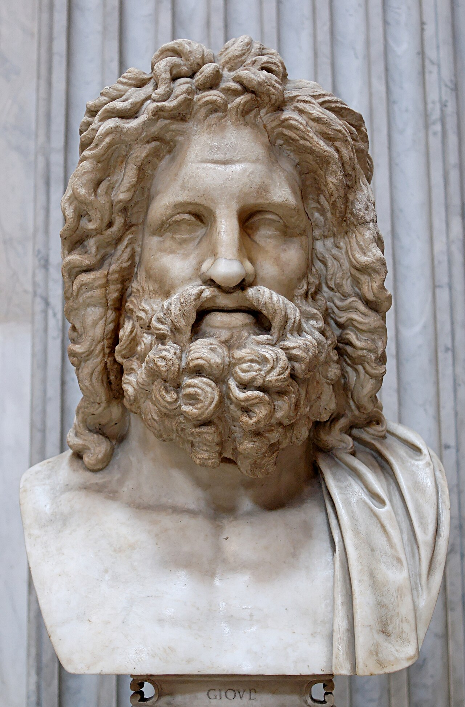

他是众神之王，也是荷马笔下最"拧巴"的一位：全知却常常束手，公正却又偏私，手握雷霆却要受制于命运与自己的承诺。

> 奥克里库姆宙斯胸像，罗马摹品（公元前 1 世纪），梵蒂冈庇护-克莱门特博物馆藏。图源：维基共享资源（公有领域）。

### 从被吞掉的孩子到天帝

宙斯是克洛诺斯与瑞亚最小的儿子。父亲每得一个孩子就吞进肚里，瑞亚生下宙斯时用襁褓包了块石头交差，把婴儿藏到克里特岛。宙斯长大后果然反攻：逼父亲吐出五位兄姐，释放独眼巨人与百臂巨人，十年提坦之战后把克洛诺斯锁进塔耳塔洛斯。三兄弟抽签分治——他得天空与最高权柄，雷霆是独眼巨人的谢礼。

这层来历解释了《伊利亚特》里两件事：其一，宙斯反复强调"我的决定不可更改"，因为他的王位本身就是推翻父命得来的，最怕的是秩序松动；其二，他对波塞冬的越界格外容忍——那不是臣子的抗命，是分家兄弟的讨价还价。

### 史诗里的三次关键动作

**许诺忒提斯（卷一）**：阿喀琉斯受辱，母亲忒提斯抱住宙斯的膝盖求他让特洛伊人暂时得胜。宙斯皱着眉点头——这个"点头"让希腊联军在之后十卷里节节败退，是全诗的发动机。他答应得快，代价却是让自己疼爱的英雄（萨佩冬）走向命定的死。

**黄金天平（卷八、卷二十二）**：宙斯挂起金秤，放上两方的"死亡命运"，沉下去的一端便是败亡。阿喀琉斯与赫克托耳最后一战前，天平再次倾斜——**连宙斯也只能称量命运，不能改写它**。摩伊赖（命运三女神）比众神之王更古老。

**禁令与松懈（卷十三至十五）**：他明令诸神不得参战，自己坐上伊达山观战；赫拉用美人计与睡神许普诺斯把他哄睡，波塞冬趁机下场。醒来后他一句"赫拉，你又捣鬼"，带着笑意把局面收回来——荷马笔下的天帝更像一位掌控节奏的大家长，而非暴君。

### 他的故事：权力、婚姻与变形

宙斯的"风流账"其实是古代城邦谱系的政治语言：与赫拉正式成婚（圣婚象征天地结合），与墨提斯生雅典娜（他吞下怀孕的妻子，女儿从他头颅里全副武装跳出），与勒托生阿波罗与阿尔忒弥斯，与迈亚生赫尔墨斯，与凡女塞墨勒生狄俄尼索斯，与阿尔克墨涅生赫拉克勒斯；化身公牛带走欧罗巴、化金雨探达那厄、化天鹅亲近勒达。几乎每一桩都对应某个王族或城邦宣称"我们祖上是宙斯"。

### 象征与读法

雷霆、鹰、橡树、伊达山与多多纳神谕所都归他。他的名字 Zeus 与拉丁 Iuppiter 同源于印欧语词根 *dyeu-（天空/白昼之光）。在荷马里读宙斯，不必纠结他"是否公正"：他是**秩序本身**——既允许人间厮杀，也保证誓言、客谊与葬礼这些底线不被践踏；而连他也拗不过的，是必死者的命运。
