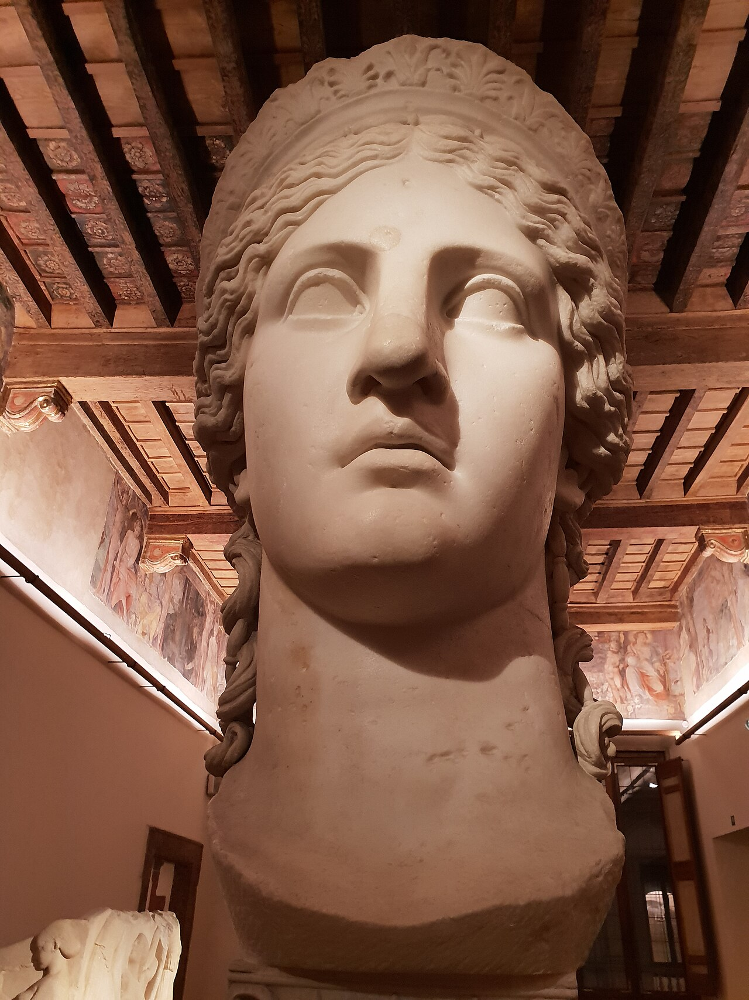

《伊利亚特》里最执拗的意志不是阿喀琉斯的愤怒，而是赫拉的记仇——为一桩选美旧账，她恨特洛伊恨到城破也不肯罢休。

> "卢多维西的朱诺"头像，罗马摹品（约公元 1 世纪），罗马国家博物馆藏。摄影：MumblerJamie，CC BY-SA 2.0，经维基共享资源。

### 姐姐、妻子与王后

赫拉是克洛诺斯之女、宙斯的姐姐，被父亲吞下又被宙斯救出；在提坦之战后与宙斯成婚，成为天后。她的名字可能意为"贵妇/女主人"，在阿尔戈斯、萨摩斯与奥林匹亚都有极古老的崇拜——**她比"宙斯的妻子"这个身份更古老**，某些学者认为她原是爱琴海地区独立的大女神，后被纳入奥林匹斯谱系。婚姻与合法继承是她的领域，孔雀、牛与石榴是她的标志。

### 一桩裁判，十年战争

"帕里斯的裁判"是她全部动机的源头：不和女神厄里斯在珀琉斯与忒提斯的婚宴上掷下刻着"献给最美者"的金苹果，赫拉、雅典娜、阿佛洛狄忒争起来。三位女神分别向特洛伊王子帕里斯许诺**王权、智慧与战功、世上最美的女人**，帕里斯选了阿佛洛狄忒，带走斯巴达王后海伦。落选的两位从此成了特洛伊的死敌。

于是史诗里出现耐人寻味的一幕：赫拉为了帮希腊人，竟不惜帮助她一贯厌恶的阿伽门农阵营；她甚至提出"等我毁掉特洛伊，你别阻拦"，与宙斯讨价还价。

### 卷十四：教科书级的一次操控

希腊联军被逼到船边、赫克托耳正要放火烧船，赫拉决定亲自下场。她向阿佛洛狄忒借来能令神与人都动情的刺绣腰带，梳妆、熏香，登上伊达山；宙斯一见她便"心被情欲笼罩"，两人躺进金云里，睡神许普诺斯趁机合上宙斯的眼。就在天帝打盹的这一会儿，波塞冬冲到前线，埃阿斯用巨石砸伤赫克托耳，战局逆转。

荷马写这段的笔调是带笑的：天后用最古老的手段赢了一天，而宙斯醒来后也只是识破而非震怒。神明不道德，但**极有人味**——这正是荷马的神最迷人的地方。

### 她的故事：被冒犯的秩序

赫拉的神话大半围绕"婚姻被冒犯"展开：她追杀宙斯的情人与私生子（逼伊俄流浪、让塞墨勒自焚、把幼年赫拉克勒斯的摇篮里放蛇，后来又因被骗去哺育他而震怒），曾联合波塞冬与雅典娜把宙斯绑起来（被百臂巨人吓退），还把 Hephaestus 跛足的原因归为"我生的孩子不够体面，自己把他扔下奥林匹斯"——不同版本互相打架，却都指向同一件事：**她捍卫的不是爱情，是名分**。

### 在《奥德赛》里

她几乎不出场，但余威还在：正是她与雅典娜当年的落选，铺出了十年特洛伊战争，也就铺出了奥德修斯十年的归途。一个不在场的女神，撑起了另一部史诗的前史。
