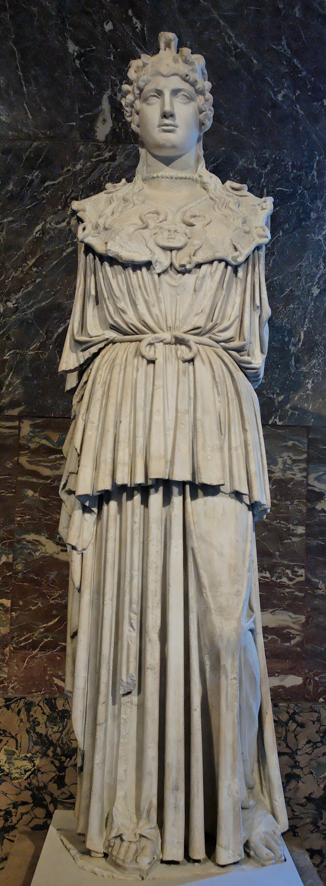

如果《奥德赛》有一位幕后导演，那一定是雅典娜：她不在船上，却几乎安排了归乡的每一幕。

> 菲迪亚斯《雅典娜·帕特农》罗马大理石摹本，卢浮宫藏。图源：维基共享资源（公有领域）。

### 最不像"出生"的出生

宙斯与墨提斯（"智谋"的化身）结合，却听信预言"墨提斯之子将推翻父亲"，于是把怀孕的妻子一口吞下。此后宙斯头痛欲裂，赫菲斯托斯（一说普罗米修斯）一斧劈开他的头颅，**雅典娜全副武装、持盾执矛、呐喊着跳了出来**。她因此兼得父亲的权柄与母亲的智谋，终生处女（帕特农 Parthenos 即"处女"），别号"灰眼女神""特里托革尼亚"。猫头鹰、橄榄树、蛇与埃癸斯神盾归她。

她与波塞冬争雅典守护权：他击石出咸泉，她种下橄榄，公民判橄榄更有用，城市遂以她为名。这则故事几乎是她的自我定义：**不靠蛮力，靠有用的智慧**。

### 《伊利亚特》：按住头发的手

卷一阿喀琉斯拔剑要砍阿伽门农，是雅典娜从背后按住他金发，低声许他"将来三倍补偿"——全诗第一个转折由她完成。卷五她借狄俄墨得斯之手刺伤阿瑞斯与阿佛洛狄忒，把"战术智慧"与"纯粹暴怒"放在一起对照。卷二十二她骗赫克托耳停下脚步（化作弟弟得伊福玻斯），把最勇的人交给命运。她帮希腊，但从不无条件：她要的是**有分寸的勇**。

### 《奥德赛》：整部诗的隐形编剧

卷一她在众神会议上替奥德修斯求情；卷二化作门托尔鼓动忒勒马科斯出海寻父；卷五安排卡吕普索放人；卷六托梦给瑙西卡公主去海边洗衣，让落难者遇见救星；卷七化雾把他送进王宫；卷十三与他坐在橄榄树下定下复仇全盘计划，把他变成老乞丐、连妻子都认不出；卷二十二在厅堂里举着埃癸斯盾，让求婚者的投枪全部落空；卷二十四最后出面按住伊萨卡的血仇，换来和平。

**她欣赏的是"智"**：奥德修斯谎话连篇、忍辱负重、见机行事，恰恰是她最偏爱的品质。两部史诗里同一位神，偏好完全一致。

### 故事与象征

她庇护的凡人是一长串"手艺与计谋"的名字：帮珀耳修斯斩美杜莎（把头颅镶进自己的盾）、助赫拉克勒斯、教阿拉克涅织布（后者挑战她而变蜘蛛）、把盲诗人忒瑞西阿斯的故事与纺织、造船、陶艺连在一起。罗马人叫她密涅瓦。

在荷马的世界里，她是把"神意"翻译成"人的办法"的那位神：从不出奇迹，只让该发生的事在对的时机发生。读《奥德赛》时，你几乎可以把她读作奥德修斯自己的**谋略**——就像卷一她自己说的："我们俩都最懂计谋。"
