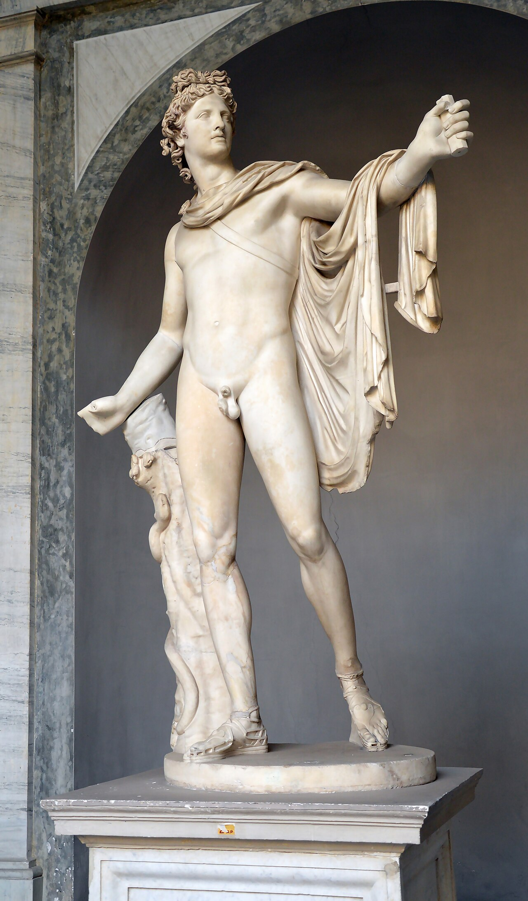

《伊利亚特》第一场灾难不是人打人，而是神射箭：阿波罗的银弓一响，希腊军营先死骡狗，再死人，九天焚尸的火不灭——全诗从一位神的愤怒开始。

> 观景殿阿波罗，罗马摹品（约公元 2 世纪，仿公元前 4 世纪希腊原作），梵蒂冈博物馆藏。摄影：Livioandronico2013，CC BY-SA 4.0，经维基共享资源。

### 勒托之子，提洛岛的月光

宙斯与提坦女神勒托结合，赫拉震怒，不许大地给她容身之处，又派巨蟒皮同追杀。勒托最后在浮岛提洛岛（一说俄耳堤癸亚）生下双胞胎：**阿尔忒弥斯先落地，随即帮母亲接生了阿波罗**。他长大后在德尔斐射杀皮同，接管了那里的神谕——"认识你自己"那句箴言就刻在阿波罗神庙上。银弓、里拉琴、月桂、乌鸦、德尔斐三足鼎归他；别号"福玻斯"（光耀）、"吕刻俄斯""银弓之神"。

他是奥林匹斯神里"职能最多"的一位：光明与音乐、医药与瘟疫、预言与射箭、殖民与牧群——看似矛盾，其实一体：**能带来病，也能收走病；能射远箭，也能奏远音**。

### 史诗里：他站在城墙那一边

卷一，祭司克律塞斯求还女儿被阿伽门农羞辱，向阿波罗祈祷；神"从奥林匹斯山顶怒冲而下，箭袋在肩上哗响"，降下瘟疫——逼出阿喀琉斯与阿伽门农的争吵，也逼出全诗主题"愤怒"。

卷十六，帕特洛克罗斯披阿喀琉斯甲胄冲到特洛伊城下，**阿波罗三次把他挡回、击落他的头盔、解开他的胸甲**，再由欧福耳玻斯刺伤、赫克托耳补上致命一击。卷二十一诸神混战，他避开与波塞冬交手（"为凡人打架不值得"）；卷二十二他化作阿革诺耳引开阿喀琉斯，替特洛伊多争了一口气。卷二十四他甚至在众神会议上替赫克托耳的遗体说话，指责阿喀琉斯"把怜悯丢在身后"。

阿喀琉斯之死也与他有关：传说他（或借帕里斯之手）引导那支射向脚踵的箭——特洛伊的守护神，最终收走了希腊最勇的人。

### 故事：最美的拒绝与最重的惩罚

他最著名的故事几乎都是"求而不得"：追求达佛涅，她宁愿变月桂；爱上卡珊德拉，赠她预言能力又被她拒绝，遂使她的预言永无人信（特洛伊无人听信木马警告，源头在此）；与玛耳珀萨、克瑞乌萨、许阿铿托斯（误掷铁饼致死，血里长出风信子）……还有音乐上的骄傲：与玛息阿斯比赛，赢后剥皮；弥达斯判潘获胜，被他换成驴耳。

他也有温柔的一面：为克里特公主阿里阿德涅、为被追杀的俄瑞斯忒斯主持净化；每年夏天乘天鹅车回许珀耳玻瑞亚人那里，德尔斐便"闭门"一季。

### 与荷马的距离

有意思的是，荷马从不用"太阳神"称呼他——**太阳在史诗里是赫利俄斯**，阿波罗是光、预言与弓箭之神（二者合流是很晚的事）。在《伊利亚特》里，他代表的是另一种与雅典娜相反的力量：雅典娜让人的计谋生效，阿波罗让人的勇武**在某一刻突然失效**。城墙上那尊银弓，是必死者无论如何努力也绕不过去的一面。
