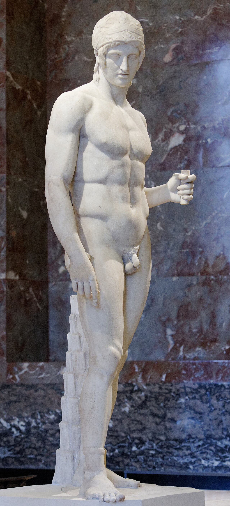

没有哪位神像阿瑞斯这样，在自己的领域里屡屡吃瘪：他是战神，却被凡人刺伤、被姐妹砸倒、被天后当众数落"你这没良心的"。荷马对他的态度，几乎就是整部《伊利亚特》对战争本身的态度。

> 阿瑞斯·博尔盖塞，罗马大理石摹本（公元 1–2 世纪，仿公元前 5 世纪希腊青铜原作），卢浮宫藏。摄影：Marie-Lan Nguyen，CC BY 2.5，经维基共享资源。

### 最不受待见的奥林匹斯神

阿瑞斯是宙斯与赫拉的独子（赫西俄德说赫拉独自因触怒宙斯而生），象征战争中**最不讲理的那部分**：嗜血、喧嚣、混战与屠城。他的随从是得摩斯（恐惧）、福波斯（惊惶）、厄里斯（纷争）与厄倪俄；武器是长矛与火把，座驾是四匹火马，圣物是秃鹫与狗。罗马人叫他玛尔斯——后者反而体面得多，是军团与建国之父。

在荷马里连宙斯都嫌他："你是我最恨的神，你只爱争吵、打仗和杀戮。"（卷五）这句训斥很不寻常：天帝很少公开羞辱自家孩子。

### 卷五：战神的两次受辱

特洛伊王子赫克托耳与埃阿斯鏖战时，阿瑞斯亲自下场助特洛伊。雅典娜便披上隐身盔、扶着狄俄墨得斯的手，让凡人的长枪**扎进阿瑞斯的小腹**——神流出"灵液"，痛得"像九千或一万个士兵一起呐喊"，当场退回奥林匹斯告状。宙斯不但不帮他，还叫医神给他敷药，顺便骂了一顿。

卷二十一诸神混战，雅典娜更直接：捡起一块黑石砸在他脖子上，把他撂倒在地，笑说"你连我这点力气都扛不住，还敢跟我比？"——**两位"战争神"被摆在一起对照**：阿瑞斯是盲目的暴力，雅典娜是克制的战术。荷马把胜负判给后者，立场再清楚不过。

### 故事：金网里的丑闻

阿瑞斯最著名的逸事与战场无关：他与阿佛洛狄忒私通，被她丈夫赫菲斯托斯用一张看不见的金网罩在床上，诸神被请来围观，赫尔墨斯笑说"哪怕被三倍锁链捆住，我也愿意和她睡一觉"（《奥德赛》卷八由盲歌手得摩多科斯唱出，正是宴席上最欢乐的一支歌）。荷马借这首歌调侃的，是**暴力在爱与技艺面前毫无体面**。

他还与忒拜王室的起源有关：与凡女哈耳摩尼亚生下塞墨勒等，其后裔纠缠出俄狄浦斯一族的诅咒；与厄倪俄的故事、被阿洛阿代兄弟（俄托斯与厄菲阿尔忒斯）绑进铜瓮关了十三个月，也都要靠赫尔墨斯偷偷救出。

### 在特洛伊的立场

他站特洛伊一边，却与阿波罗、赫克托耳那种"护城"的责任感不同：他只是**想打**。所以荷马从不给他高光，只给他伤口与笑声。读阿瑞斯，读的是荷马对战争最冷的一句评语：喊得最响的那位，往往最不值得尊敬。
