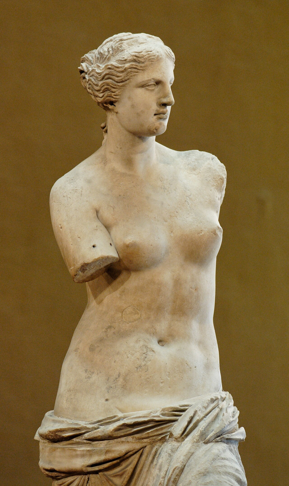

特洛伊战争最流行的起因，是她递出的一件"奖品"；而她在战场上唯一一次亲自出手，换来的却是一只被凡人划破的手腕。

> 米洛的阿佛洛狄忒，约公元前 130–100 年，卢浮宫藏。图源：维基共享资源（公有领域）。

### 从海沫里升起的更古老者

荷马说她是宙斯与狄俄涅之女（《伊利亚特》卷五）；赫西俄德却讲了一个更古老的版本：乌拉诺斯被儿子克洛诺斯割下的残体落进海里，浪沫（aphros）中升起一位全裸的女神，先在基西拉、后到塞浦路斯上岸——**她比奥林匹斯这一代更老**，是近东的伊什塔尔/阿斯塔特经腓尼基传入爱琴海的变形。两说并存，正好对应她的两面：天上的儿女，与比天更古老的欲望本身。

她嫁给了最不起眼的赫菲斯托斯（神匠），却与阿瑞斯、赫尔墨斯、阿多尼斯、凡人安基塞斯都有故事；厄洛斯（丘比特）常被算作她的随从或儿子。玫瑰、桃金娘、鸽子、麻雀、贝壳与镜子归她。

### 一桩裁判点燃十年战火

珀琉斯与忒提斯婚宴上，厄里斯掷下"献给最美者"的金苹果。三位女神各自开价：赫拉许王权、雅典娜许智慧与战功、**阿佛洛狄忒许"世上最美的女人"**。帕里斯把苹果判给了她。她随即"兑现"：把斯巴达王后海伦带到特洛伊（一说只是幻影，真海伦在埃及——欧里庇得斯后来这样翻案）。

于是赫拉与雅典娜成了特洛伊的死敌，而她自己成了**特洛伊的守护者之一**——不是出于道义，是护着那桩裁判的成果。荷马写得很克制：卷三她在城头劝海伦回到帕里斯身边，被海伦一句"你自己去找他吧"顶回去；卷五她冲进战场救儿子埃涅阿斯，被狄俄墨得斯一枪划破手腕，"灵液"流出，丢下儿子逃回奥林匹斯，被雅典娜与赫拉笑着打趣。

### 她的故事：爱、美与代价

最著名的是与阿多尼斯：少年被野猪撞死，她悲恸中让血里长出银莲花（一说玫瑰因此变红）；与凡人安基塞斯结合，生下埃涅阿斯——**罗马人正是借这个儿子把家谱接回特洛伊，再由维吉尔写成《埃涅阿斯纪》**。还有皮格马利翁：雕刻家爱上自己的象牙少女，她赐雕像活过来；希波吕托斯拒绝她的祭仪，她借继母淮德拉之手毁掉他（欧里庇得斯《希波吕托斯》）。金网捉奸那一幕（见「阿瑞斯」篇）在《奥德赛》卷八被唱成宴席上的笑谈。

### 与雅典娜、赫拉的三角

三女神的竞赛其实是三种人生理想的竞赛：**权力 / 智谋 / 爱欲**。帕里斯选了第三样，荷马随后用十卷战事、一座焚城来给这个选择标价。她不解释、不辩护，只在城头替海伦拢一拢面纱——欲望从来不为后果负责，这恰是她最"神"的地方。
