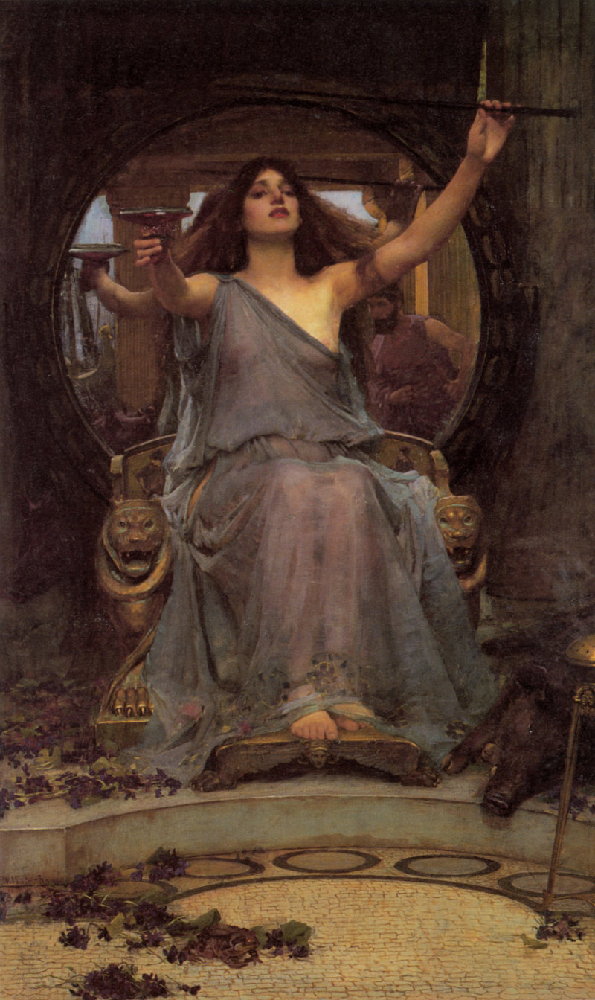
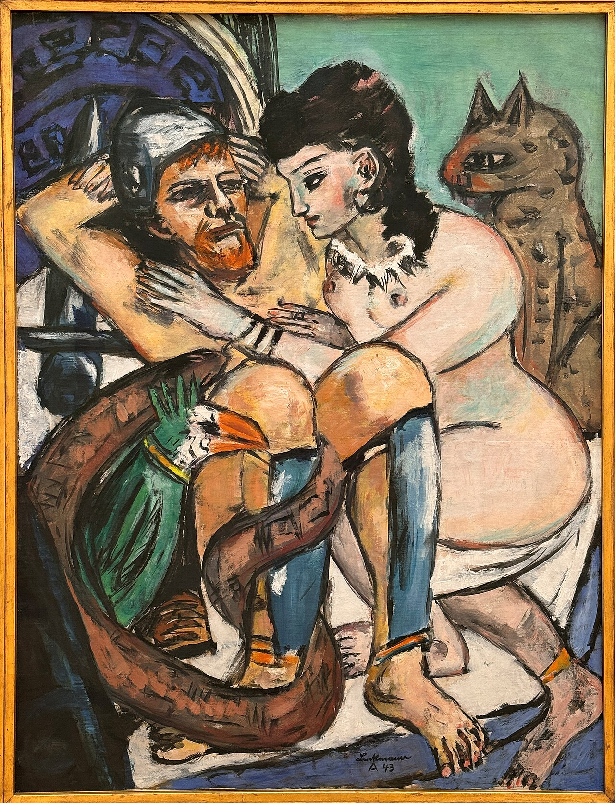

《奥德赛》里最危险的两位女性都不是凡人，也不在奥林匹斯的编制内：一个把人变成猪、一个许诺永生。她们留人的方式截然不同，却共同提出同一个问题——**归乡，究竟值得放弃什么？**

> 约翰·威廉·沃特豪斯《喀耳刻向奥德修斯递杯》，1891 年。图源：维基共享资源（公有领域）。

> 马克斯·贝克曼《奥德修斯与卡吕普索》，1943 年，汉堡美术馆藏。摄影：Dguendel，图源：维基共享资源（公有领域）。

### 喀耳刻：埃亚亚岛的药剂师

她是太阳神赫利俄斯与大洋神女珀耳塞之女，通药草与咒语，居埃亚亚岛（后世比定为意大利奇尔切奥山一带，见「航海地图」）。Medea 是她的侄女；她与奥德修斯生下忒勒戈诺斯（《忒勒戈尼亚》的主角，见本栏「循环史诗」辑）。

卷十：奥德修斯派去探路的一队人被她请进厅堂、吃喝之后一杖变成猪，**只有警惕的欧律罗科斯逃回**。赫尔墨斯半路递来圣草摩吕，教他逼她起誓不再加害；他持剑冲进去，她反而认出"你就是赫尔墨斯说过的那个人"，邀他同住。同伴变回人，一住就是一年。临行她没有挽留，只指了两条路：先去冥府问忒瑞西阿斯，再过塞壬与窄峡——**她把最有用的情报给了他**，临别还备好顺风与献祭的羊。

喀耳刻的"魔法"因此更像一次试炼：她夺走人的形，却还给人方向。后世画家（沃特豪斯、伯恩-琼斯）爱画她举杯的那一刻，镜中映出猪与船，正是"变形与选择"的视觉双关。

### 卡吕普索：俄古癸亚岛的永生报价

她是阿特拉斯之女（一说大洋神女），名 Kalypso 与"遮蔽/覆盖"同源——**连名字都在说"把人藏起来"**。居俄古癸亚（一说马耳他戈佐岛），岛上嘉木成荫、泉水分四道流淌，她织布、歌唱，洞外是永不着陆的海。

卷五开篇，奥德修斯已在岛上七年（全诗时间线上他此刻被"藏"得最久）：她救了落水的他，许他"永生不老、与我同住"，他却夜夜坐在海边望着伊萨卡的方向流泪。众神议事，雅典娜提议放行，宙斯派赫尔墨斯传令；她听完先抱怨"你们神总不许女神爱凡人"，仍亲手给他斧与木料、指路、送顺风——**挽留是真，放手也是真**。

她与喀耳刻恰成一对：一个给方法、一个给永恒；一个让人变回自己，一个请人不必再做自己。奥德修斯对费埃克斯人讲这段时说得很直白：妻子珀涅罗珀不如她美貌，可"我仍天天想回家"——归乡的意义，正是在这两座岛上被称出重量的。

### 故事之外

后世给两位"女巫/仙女"添了许多续篇：喀耳刻与忒勒马科斯、与忒勒戈诺斯的谱系（循环史诗《忒勒戈尼亚》）、卡吕普索在《奥德赛》之后为奥德修斯生子的说法，都属晚出。荷马自己只留两笔最克制的：魔药与圣草，木筏与顺风。**她们不是反派，是两道选择题。**
