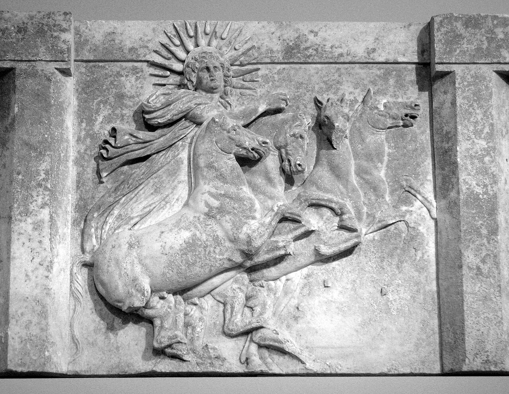

荷马的世界里还有一些"不在奥林匹斯却无处不在"的力量：太阳每天赶路、亡魂住在地下、风被装进皮袋、睡眠能放倒天帝。他们戏份不多，却常在关键处决定生死。

> 特洛伊（伊利昂）雅典娜神庙檐壁浮雕：太阳神赫利俄斯驾四马战车，约公元前 300–280 年，柏林旧博物馆藏。摄影：Mark Landon，图源：维基共享资源（公有领域）。

### 赫利俄斯：每天驾车经过的目击者

提坦神许珀里翁与忒亚之子，月神塞勒涅、黎明女神厄俄斯的兄弟。他**不是阿波罗**（荷马从不用"太阳神"称阿波罗，二者合流是后来的事）：每天驾四马金车从东边大洋升起、西边落下，夜里乘金杯绕回东方；因为他"什么都看得见"，誓约常请他作证。

《奥德赛》卷十二，他的女儿们（法厄图萨与兰珀提厄）在特里纳基亚岛牧着三百六十五头不老不死的圣牛。同伴趁奥德修斯睡着宰了牛，他直接向宙斯告状："若不赔，我就下到冥界去照死人！"宙斯只得劈碎归船——**全书唯一一次由"太阳"本人促成的雷霆**。

他最出名的故事是儿子法厄同：少年强驾日车失控，大地将燃，宙斯一雷把他击落；此外还有他向赫菲斯托斯泄露阿瑞斯与阿佛洛狄忒私情（换来金网那一幕）、把俄里翁治好（一说弄瞎）等枝节。罗德岛的太阳神巨像（世界七大奇迹之一）是他的最著名造像，上图特洛伊出土的那块檐壁浮雕，则让"太阳照在特洛伊城上"这句史诗意象有了实物。

### 哈得斯与冥界：不在场的在场者

抽签得冥界的克洛诺斯长子，别号"看不见者"（Aidoneus/普勒同，因"财富"从地下出），妻珀耳塞福涅（劫走她的故事见《荷马诗颂·得墨忒耳》），守门犬刻耳柏洛斯、渡船卡戎、冥河斯堤克斯与勒忒、审判者米诺斯等归其治下。荷马刻意**从不让他进奥林匹斯的会议**——冥界是另一套秩序。

《伊利亚特》卷九阿喀琉斯说"哈得斯之门我最恨，他藏着一切"；卷二十三帕特洛克罗斯的魂魄入梦求葬；《奥德赛》卷十一奥德修斯在大地尽头挖坑、以血引魂，见忒瑞西阿斯、母亲安提克勒娅与阿伽门农、阿喀琉斯等旧友——阿喀琉斯那句"我宁愿在人间给穷汉当雇工，也不愿统辖全部亡灵"，是两部史诗对永生最锋利的反驳。**冥界诸神的作用，是给"必死"标价。**

### 风、睡、彩虹、命运：一群"职能神"

- **埃俄罗斯**：风的总管（荷马里是人间王、受神托付），赠奥德修斯一只装着全部逆风的皮袋；同伴在望见伊萨卡时解开，船被吹回原点——全书最冤的一次溃败（卷十）。
- **许普诺斯（睡神）与塔纳托斯（死神）**：孪生兄弟，夜神倪克斯之子。卷十四赫拉许他一张金椅，请他**放倒宙斯**；卷十六他俩把萨佩冬的遗体轻轻送回吕基亚——同一对手，一次骗过天帝，一次替凡人收尸。
- **伊里斯**：彩虹女神、宙斯的传令员（赫尔墨斯管"跑腿"，她管"传话"），卷二化身为普里阿摩斯之子波吕忒斯催特洛伊人出战，卷八、卷十五替宙斯给赫拉与波塞冬送禁令。
- **摩伊赖（命运三女神）**：克洛托纺线、拉刻西斯定长、阿特洛波斯剪断。荷马极少让她们露面，却借宙斯之口承认：**连他也救不了命定的萨佩冬**。
- **琉科忒亚（伊诺）**：凡女成神的海中救助者，卷五抛出神纱，让波塞冬浪里的奥德修斯裹住胸口、游上岸；**埃俄罗斯的女儿、卡吕普索的岛、赫利俄斯的牛**，恰好把《奥德赛》卷五至十二的险境串成一条"自然神"的走廊。

这些神没有雕像、没有神庙、没有谱系大戏，却是荷马世界里最贴近日常的那一层：太阳照常升起、风忽然转向、人在该睡的时候睡着、在该死的时候谁也留不住。
