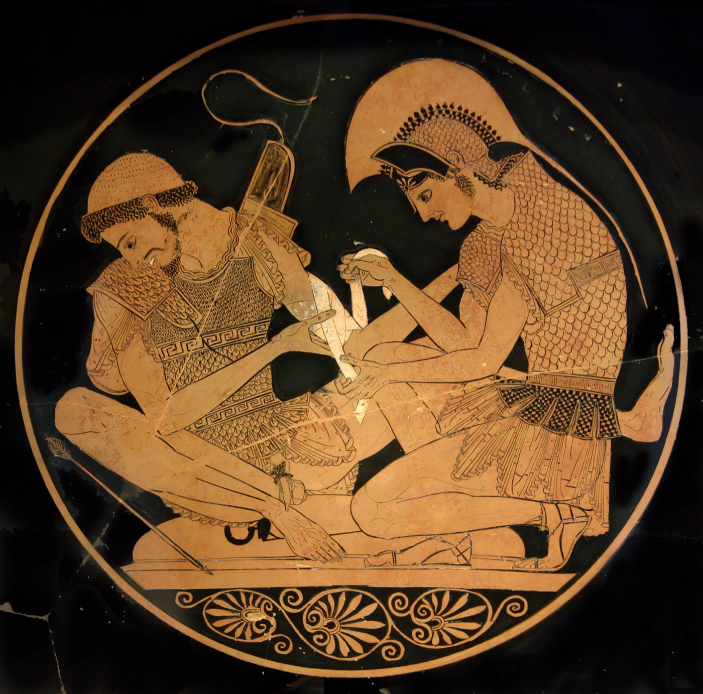
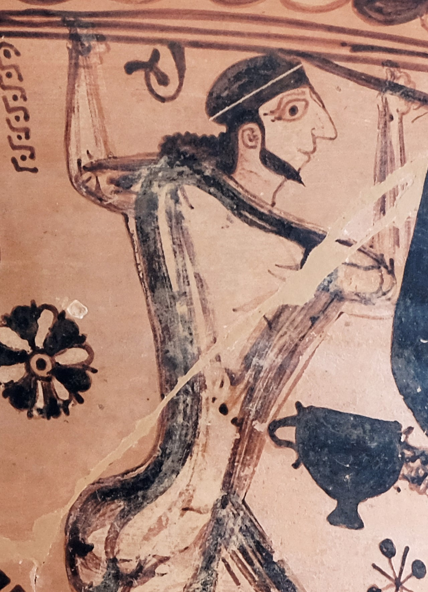
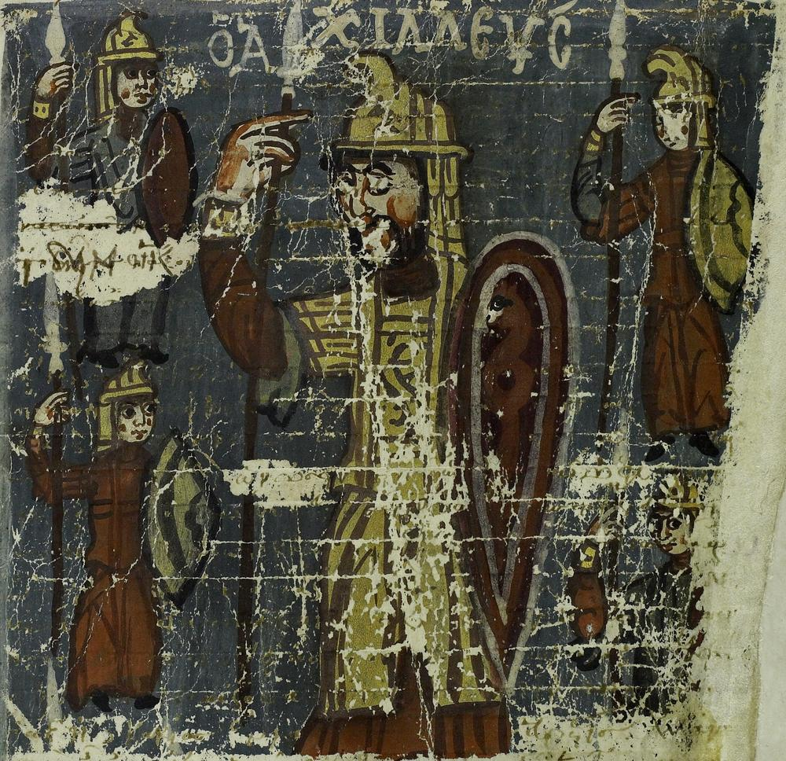
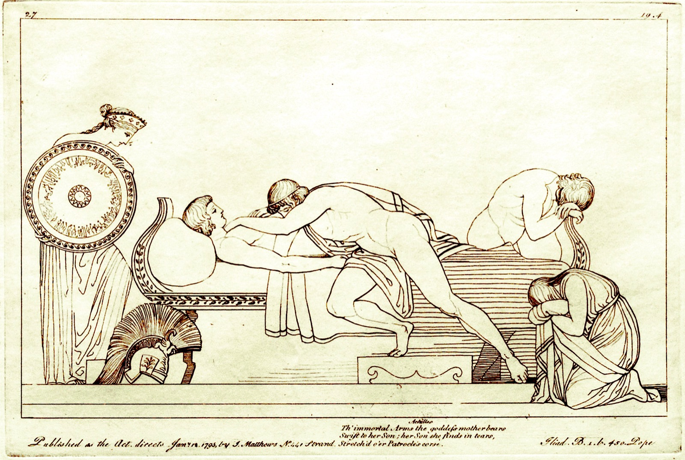
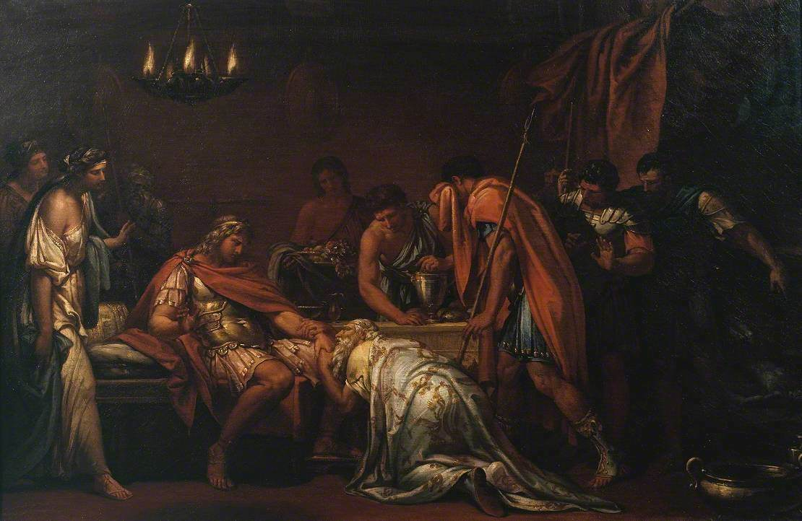
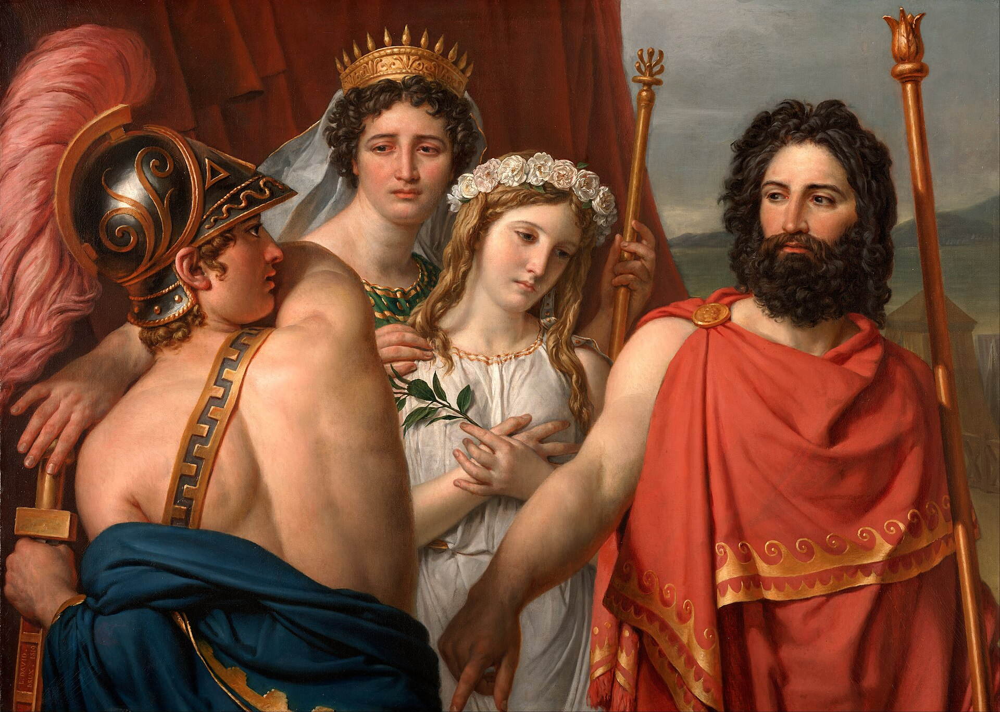
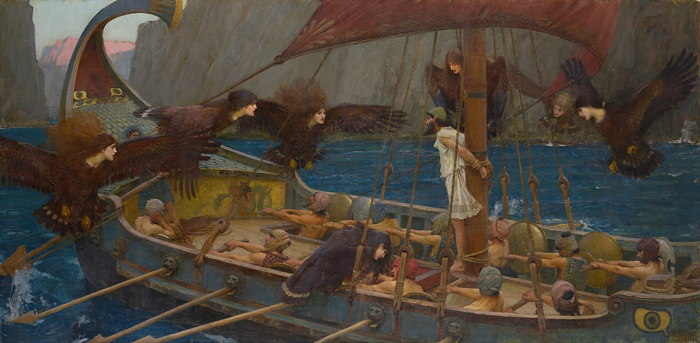

在成为"书"之前，荷马首先是"画"。识字的人永远是一小部分，看图的人是所有人：从公元前七世纪起，希腊陶瓶画家就把特洛伊战争与奥德修斯的漂泊画上陶器，比现存最早的完整抄本早了一千多年。此后两千年，这条图像的长河流过抄本、铜版画、学院油画，流到今天的银幕与游戏——也流到本站这些小人书风格的插图里。本文借维基共享资源提供的九幅名作，把这条河粗粗走一遍。

### 陶瓶上的史诗

希腊人饮酒、盛油、陪葬都用陶器，陶器上黑红两色的小画，就是他们最日常的"连环画"。题图那只黑绘双耳瓶出自埃克塞基亚斯之手：围城的间隙，阿喀琉斯与埃阿斯放下长矛，对坐掷骰子——两人手仍握矛，身体前倾，唇边只吐出数字。全希腊最凶悍的两个战士，被画成了一盘安静的棋局。埃克塞基亚斯在瓶身签了名：既是画师，也是陶工。

红绘技法成熟后，画家有了更细腻的笔。柏林那只名杯的内壁上，阿喀琉斯正用布条为帕特罗克洛斯包扎臂上的箭伤：伤者咬紧牙关，包扎者俯身凝神——史诗里最铁的两个人，画面里只剩照顾与疼痛。陶瓶画家似乎天生懂荷马：他们画坚甲，更画甲胄下的身体。

> 阿提卡红绘基里克斯杯（内壁），索西阿斯造，画师一般归于"索西阿斯画师"，约公元前500年，柏林旧博物馆藏。图源：维基共享资源（公有领域）。

《奥德赛》同样很早就入了画。埃莱夫西斯出土的巨型双耳瓶上，奥德修斯与同伴高举木桩刺向独眼巨人波吕斐摩斯——这只约公元前650年的瓶子，是已知最早描绘刺瞎波吕斐摩斯的图像。巨人的狰狞与小人的果决挤在瓶腹上：六音步的诗行还没有被写定，故事已经先在泥釉里活了。

> 原始阿提卡式双耳瓶（"波吕斐摩斯瓶"），约公元前650年，埃莱夫西斯考古博物馆藏。摄影：Davide Mauro，CC BY 3.0，经维基共享资源。

### 抄本与线条

图像长河里还有一条安静的支流：抄本。威尼斯圣马可图书馆藏的"威尼斯抄本 A"约抄写于公元十世纪，是《伊利亚特》现存最早的完整抄本，页缘与行间写满古代学者传下的注疏——亚历山大里亚校勘家们的批注，就靠这页纸活到了今天。现代校勘本翻开第一页，脚注里站满的正是这些小字。

> 《伊利亚特》"威尼斯抄本 A"（Venetus A），约公元10世纪抄写，页缘存古代注疏，威尼斯圣马可国家图书馆藏。图源：维基共享资源（CC0）。

十八世纪九十年代，英国雕塑家弗拉克斯曼为《伊利亚特》设计了一套轮廓线插图，由皮罗利刻成铜版：没有阴影，没有背景，只有一根流畅的线牵着人形。欧洲看惯了浓油重彩的眼睛被这根线烫了一下——"高贵的单纯与静穆的伟大"从此有了图样本，新古典主义与后来的浪漫派都从这里取过火种。

> 汤马索·皮罗利据约翰·弗拉克斯曼画稿刻《忒提斯把新甲送到悲恸的阿喀琉斯身边》，《伊利亚特》插图组画之一，1795年。图源：维基共享资源（CC0）。

### 画布上的英雄时代

十八世纪下半叶，荷马正式登上大画布。苏格兰画家加文·汉密尔顿1763年画《普里阿摩斯求尸》：特洛伊老王夜入敌营，亲吻阿喀琉斯那只"杀人的手"，求他还回儿子的遗体。画中人跪立如白色大理石像，画面深处却烧着恻隐——本站「名场面细读 · 吻手」逐句拆解的正是这一幕。

> 加文·汉密尔顿《普里阿摩斯向阿喀琉斯求还赫克托耳遗体》，1763年，伦敦泰特美术馆藏。图源：维基共享资源（公有领域）。

画出《马拉之死》与《拿破仑加冕》的大卫，1819年画《阿喀琉斯的愤怒》：海洋女神忒提斯仰望着坐在兵器箱上生闷气的儿子——史诗第一主题"愤怒"，被画成了一幕母子家常。而到了1891年，沃特豪斯的《尤利西斯与塞壬》里，奥德修斯被绑在桅杆上，塞壬们自腥红的天空扑向船舷——维多利亚时代要的已不是大理石的静穆，而是让人脊背发凉的美。

> 雅克-路易·大卫《阿喀琉斯的愤怒》，1819年。图源：维基共享资源（公有领域）。

> 约翰·威廉·沃特豪斯《尤利西斯与塞壬》，1891年，墨尔本维多利亚国家美术馆藏。图源：维基共享资源（公有领域）。

### 每个时代画自己的荷马

从陶瓶的侧脸正眼，到弗拉克斯曼的一根线，再到塞壬头顶的红天——图像史证明，荷马从不需要被忠实复制，他只需要被一遍遍重画。想看全这条河，可以去[名场面画廊](/apps/gallery.html)：本站的小人书彩图与这些黑白灰的祖先正在同一面墙上——那正是两千八百年的回声在视觉里的样子。
