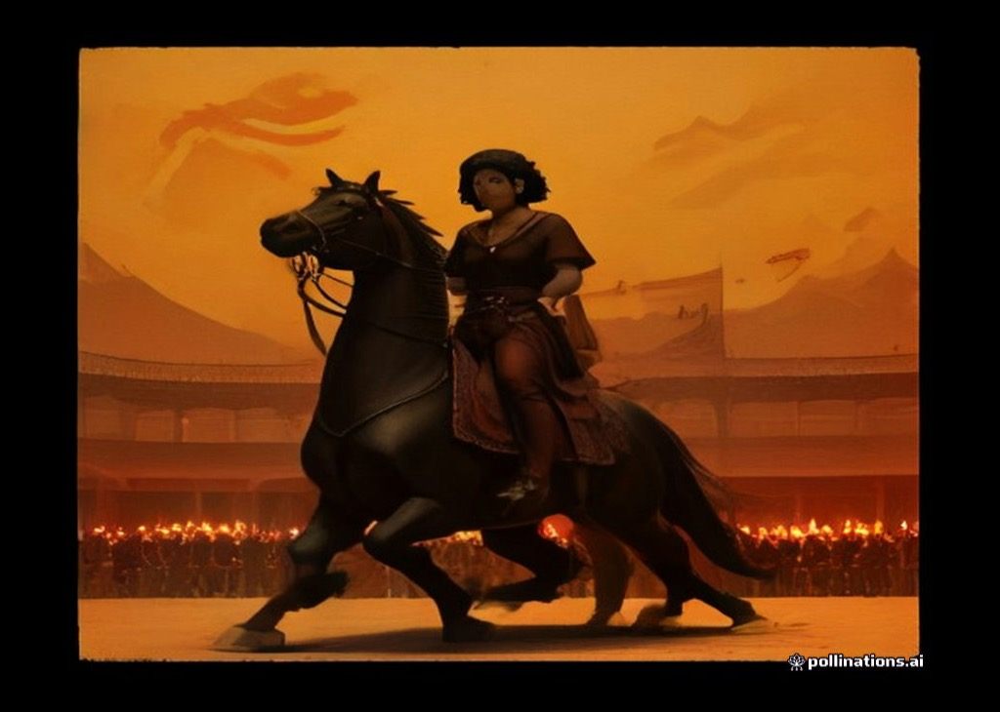
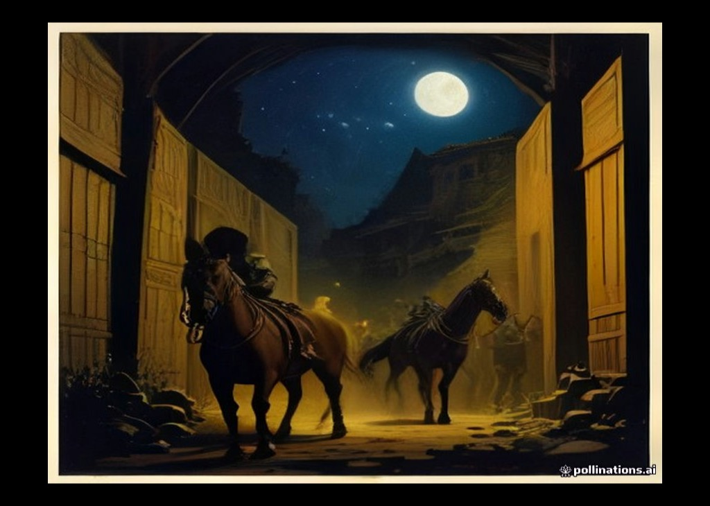

用四格连环画试试把《小伊利亚特》《伊利乌斯的陷落》两卷浓缩成一幅条漫——画风与正文插图同源，取"小人书"的分镜法：远、中、近、夜。

**第一格 · 建马**。奥德修斯献计，工匠埃佩俄斯督造木马，腹中留门。画面里桅杆林立——焚营佯退的大戏，道具已经备好。

**第二格 · 入城**。特洛伊人拆了半段城墙拉马过门，花环挂满马颈；祭司拉奥孔的长矛掷向马腹，无人肯听——知识的孤独，画在角落里。

**第三格 · 狂欢**。入夜，全城举杯，鼓乐喧天；巨马在广场中央沉默着，像一头等待时辰的兽。

**第四格 · 开门**。月沉三更，马腹暗门滑开，勇士鱼贯而出；远处火光起，城门洞开——十年战争，在一格画面里终结。

四格之间留白即"史诗的省略"：丹麦王子式的独白、拉奥孔之死、海伦的最后一夜，都藏在格与格之间。若你喜欢这种形式，后续可为每卷配一组。
